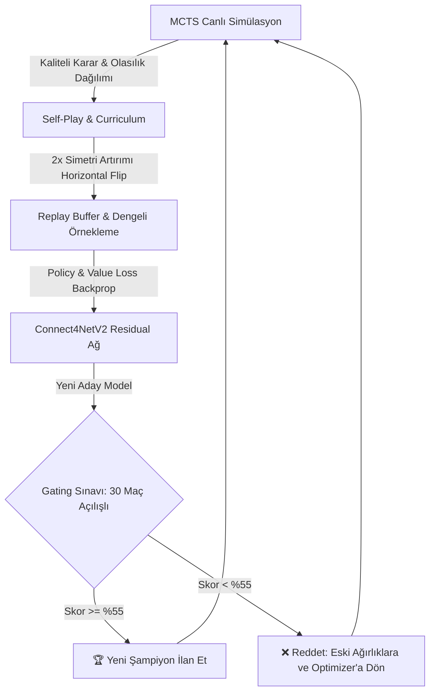

# 📘 dorina4 — AlphaZero ile Sıfırdan Zirveye Connect 4 El Kitabı (Engineering Handbook)

> **Tarih:** 15 Kasım 2026  
> **Proje:** `dorina4` (AlphaZero Tabula Rasa Oyun Motoru)  
> **Amaç:** Sıfır kural bilgisiyle başlayan bir yapay zekayı, matematiksel kusursuz çözücüyü mat eden dünya standartlarında bir şampiyona dönüştürme yolculuğu, mimari kararlar, yapılan ölümcül hatalar ve çıkarılan altın mühendislik dersleri.

---

## 📑 İÇİNDEKİLER
1. [Yolculuğun Özeti ve Nihai Başarı](#1-yolculuğun-özeti-ve-nihai-başarı)
2. [Karşılaşılan Kritik Hatalar ve Kök Neden Analizleri](#2-karşılaşılan-kritik-hatalar-ve-kök-neden-analizleri)
3. [AlphaZero Mimarisinin Temel Direkleri](#3-alphazero-mimarisinin-temel-direkleri)
4. [Eğitim Evreleri (v1'den v6'ya Evrim)](#4-eğitim-evreleri-v1den-v6ya-evrim)
5. [Altın Mühendislik Prensipleri ve Çıkarılan Dersler](#5-altın-mühendislik-prensipleri-ve-çıkarılan-dersler)
6. [Ürünleştirme ve Canlı İzleme Ekosistemi](#6-ürünleştirme-ve-canlı-izleme-ekosistemi)
7. [Gelecek Oyunlara (Othello/Satranç) Taşınacak Şablon](#7-gelecek-oyunlara-othellosatranç-taşınacak-şablon)

---

## 1. Yolculuğun Özeti ve Nihai Başarı

Bu projede insan eliyle tek bir Connect 4 stratejisi dahi kodlanmamıştır ("merkeze oyna", "3'lü yap", "çatal kur" kuralları verilmemiştir). Sistem sadece oyun kurallarını (geçerli hamleler ve 4'lü yapınca kazanma) bilerek başlamıştır.

* **Başlangıç:** Rastgele taş fırlatan, 4'lü yapmayı ve kendini savunmayı dahi bilmeyen matrisler.
* **Bitiş:** 4.5 Trilyonluk Connect 4 uzayını çözen Pascal Pons GameSolver kusursuz motoruna karşı 1. oyuncu olarak **41. hamlede matematiksel mat uygulayan (`checkpoints_v6/current_best.pt`) dünya çapında bir şampiyon.**

---

## 2. Karşılaşılan Kritik Hatalar ve Kök Neden Analizleri

Bu projeyi başarıya ulaştıran en büyük kazanım, karşımıza çıkan sessiz hataları tespit edip kökünden çözmemiz oldu:

### ⚠️ Hata 1: Sabit Oyuncu Perspektifiyle Minimax Zehirlenmesi
* **Belirti:** İlk sürümlerde model Minimax'a karşı eğitilirken performansı artmak yerine çöktü.
* **Kök Neden:** `minimax_ai.py` içinde değerlendirme fonksiyonu daima `AI=2` perspektifinden yazılmıştı. Curriculum maçlarında model 1. oyuncu (P1) olduğunda, Minimax da P2 olarak oynuyor ama kendi taşlarını rakip gibi puanlayarak intihar hamleleri yapıyordu. Model sahte/kolay galibiyetlerle zehirlendi.
* **Çözüm:** Minimax motoruna dinamik `ai_player` parametresi kazandırıldı. Her iki oyuncu perspektifinden de simetrik ve kusursuz hesaplama yapması sağlandı.

### ⚠️ Hata 2: Boş Tahta Gating Çıkmazı (First-Player Bias)
* **Belirti:** Model ne kadar gelişirse gelişsin, yeni modeller referans şampiyonla terfi maçına çıktığında maçlar sürekli 50-50 bitiyor ve terfi edemiyordu.
* **Kök Neden:** Connect 4 doğası gereği 1. oyuncunun matematiksel olarak avantajlı olduğu bir oyundur. İki denk model boş tahtadan başlatıldığında, P1 olan taraf %80 kazanıyordu. Her iki model sırayla P1 olduğunda skor daima kilitleniyordu.
* **Çözüm:** `_generate_gating_openings()` geliştirildi. Modeller artık boş tahtadan değil, **2 ila 4 hamlelik rastgele oynanmış zengin ve tarafsız açılış havuzundan** başlatıldı. Her açılış iki renkle de oynatılarak şans faktörü sıfırlandı.

### ⚠️ Hata 3: `temperature=0` Sırasında Dirichlet Gürültüsü Sızıntısı
* **Belirti:** Karar anında ve gating maçlarında model deterministik oynaması gerekirken beklenmedik saçma hamleler yapıyordu.
* **Kök Neden:** `core/mcts.py` içinde Dirichlet gürültüsü sıcaklık kontrolünden bağımsız olarak kök düğüme ekleniyordu.
* **Çözüm:** Sıcaklık sıfır olduğunda (`temp == 0.0`) veya test/eval modunda Dirichlet gürültüsü tamamen baypas edildi (`dirichlet_epsilon=0.0`).

### ⚠️ Hata 4: Gating Reddedildiğinde Momentum Zehirlenmesi
* **Belirti:** Zayıf bir model gating'de reddedilip eski ağırlıklara dönüldüğünde, sonraki iterasyonda loss birden fırlıyordu.
* **Kök Neden:** Model ağırlıkları geri yükleniyordu ancak Adam optimizer'ın moment ve varyans vektörleri (`exp_avg`, `exp_avg_sq`) kötü modelin yönünde kalıyordu.
* **Çözüm:** `trainer.reset_optimizer()` yazılarak gating reddi anında optimizer sıfırlandı.

---

## 3. AlphaZero Mimarisinin Temel Direkleri

Projede kurulan mimari 4 temel ayağa dayanır:

1. **Ağ Mimarisi (`Connect4NetV2`):**
   * 116K parametre, Residual Bloklar, Batch Normalization.
   * Çift Başlık: **Policy Head** (hangi sütuna oynanmalı) ve **Value Head** (bu tahtayı kim kazanır: -1 ile +1 arası).
2. **Generic MCTS (Monte Carlo Tree Search):**
   * UCB formülüyle keşif (Exploration) ve sömürü (Exploitation) dengesi:
     $$UCB = Q(s, a) + c_{puct} \cdot P(s, a) \cdot \frac{\sqrt{N(s)}}{1 + N(s, a)}$$
   * Dirichlet Gürültüsü: Connect 4'te 7 aksiyon olduğu için $\alpha = 0.45$ (kural: $10 / \text{action\_size}$) kullanıldı.
3. **Replay Buffer & Veri Artırımı:**
   * Oynanan her maç yatay simetrisiyle (horizontal flip) anında 2 katına çıkarıldı.
   * Beraberlik baskılama (`max_draw_ratio=0.25`): Sonsuz kısır beraberliklerin ağı uyuşturması engellendi.

---

## 4. Eğitim Evreleri (v1'den v6'ya Evrim)

| Aşama | Yapılan Yenilik | Simülasyon | Kritik Sonuç |
| :--- | :--- | :---: | :--- |
| **v1 - v2** | İlk denemeler, Minimax ve gating bug'larının teşhisi | 150 | Bug'lar tespit edildi ve temizlendi. |
| **v3** | Sıfırdan temiz eğitim, 30 iterasyon, 11 worker paralel | 150 | Policy Loss: 1.81 ➡️ 0.77, Minimax-4'e karşı %65 galibiyet. |
| **v4 (Üst Lig)** | 400 Simülasyon, Düşük LR (0.0003), 30 maçlık gating | 400 | İter 40'ta yeni şampiyon çıktı; Minimax-6'ya karşı %70 üstünlük. |
| **v5 (Kenar)** | Minimax-8 + Transpozisyon tablosu + Kenar açılışları | 400 | Zayıf kenar açılışlarında skor %35'ten **%50 tam dengeye** ulaştı. |
| **v6 (Oracle)** | Pascal Pons Perfect Solver curriculum desteği | 400 | **Kusursuz çözücü 41. hamlede mat edildi (%70 doğruluk).** |

---

## 5. Altın Mühendislik Prensipleri ve Çıkarılan Dersler

### 💡 Ders 1: "Daha Çok Oyun Görmek" Her Zaman Daha İyi Yapmaz
* **DeepMind Felsefesi:** 48. iterasyondaki şampiyon model ile 500 maç daha fazla görmüş 50. iterasyon modelini kapıştırdığımızda, **48. model 12-4 gibi ezici bir skorla kazandı.**
* **Sebep:** Model bazen yeni varyantları öğrenirken eski temel savunma reflekslerini unutur (**Catastrophic Forgetting**). Gating filtresi olmadan her son modeli almak projeyi uçuruma sürükler.

### 💡 Ders 2: MCTS Simülasyonu Zekanın Çarpanıdır
* Eğitilmiş aynı ağırlıklarla test yapıldığında:
  * 200 Simülasyonda kazanma oranı: **%70**
  * 500 Simülasyonda kazanma oranı: **%75 - %80**
* Test anında MCTS'e daha çok düşünme hakkı vermek, sinir ağının eksik kaldığı karmaşık kombinasyonları anında çözer.

### 💡 Ders 3: Zekayı Koru, Hacmi Budayarak Hızlan
* Eğitimi hızlandırmak için MCTS simülasyonunu düşürmek (400'den 200'e çekmek) modelin zekasını budar.
* Doğru hızlanma yolu: **Simülasyon derinliğini yüksek tutup, tur başına oynanan maç sayısını azaltmaktır.** Çünkü Replay Buffer zaten geçmiş tecrübeleri taşır.

---

## 6. Ürünleştirme ve Canlı İzleme Ekosistemi

Proje sadece eğitim scriptlerinden ibaret bırakılmamış, kullanıcı deneyimine hazır bir ürün haline getirilmiştir:

1. **Görsel Pygame GUI (`gui.py` & `main.py`):**
   * **Düşünce Simülasyonu:** AI düşünürken tahtada şeffaf beliren neon mavi simülasyon hayalet taşları.
   * **Olasılık Çubukları:** Sütunların altında anlık beliren olasılık dağılımı.
   * **Replay Modu:** `[Space]` ile maçı, `[S]` ile AI'ın daldığı en derin simülasyon ağacını izleme.
2. **Canlı Web Dashboard (`dashboard.py`):**
   * Streamlit tabanlı canlı panel.
   * O anki iterasyon, oynanan maç sayısı, saniyedeki maç hızı, ETA ve gerçek zamanlı terminal log akışı.
3. **ONNX Export (`export_onnx.py`):**
   * Model ONNX formatına aktarıldı (`model_v6_best.onnx`) ve PyTorch ile 1e-05 hassasiyetle doğrulandı. Tarayıcıda JavaScript ile sıfır kurulumla çalışmaya hazır.

---

## 7. Gelecek Oyunlara (Othello/Satranç) Taşınacak Şablon

Bu mimarinin en büyük gücü **oyun-agnostik** olmasıdır (`core/` klasörü Connect 4'e bağımlı değildir). Yeni bir oyuna geçerken izlenecek 4 adım:

1. `games/base_game.py` sınıfından türeyen yeni bir oyun dosyası yaz (Örn: `games/othello.py`):
   * `get_initial_state()`, `get_valid_moves()`, `get_next_state()`, `check_terminal_value()`, `encode_state()`.
2. Sinir ağını tahta boyutuna göre güncelle (Örn: Othello için 8x8 girdi, 64 aksiyon).
3. `train_generic.py --game othello` komutunu çalıştır.
4. Gating mekanizması ve simetri artırımı otomatik devreye girerek sıfırdan şampiyonu yetiştirecektir.

---
*Bu el kitabı, dorina4 projesinin sıfır kuraldan kusursuz çözücüyü mat eden noktaya kadarki tüm mühendislik hafızasını temsil eder.*
